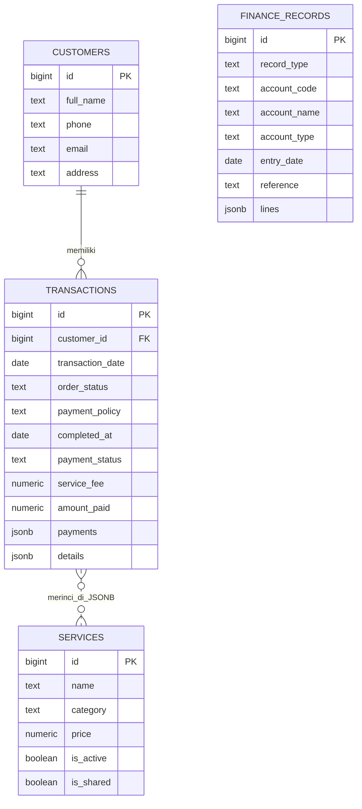

# SHOPLY

Sistem informasi akuntansi untuk jasa personal shopper fashion. Aplikasi memakai tepat empat tabel Supabase: pelanggan, layanan/produk, transaksi (termasuk rincian pesanan), dan catatan keuangan (akun serta jurnal).

🌐 **Demo aplikasi:** [Buka SHOPLY](https://bloomienay.github.io/SHOPLY/)

## Identitas tugas

| Keterangan | Detail |
|---|---|
| Nama | Nayla Clarissa |
| NIM | 12030124120008 |
| Mata Kuliah | Pengkodean dan Pemograman |
| Kelas | D |
| Dosen Pengampu | Dr. Totok Dewayanto, S.E., M.Si., Akt. |

**Disusun untuk memenuhi Tugas Project UTS Pengkodean dan Pemograman.**

## Struktur Proyek

```text
shoply/
├── README.md
├── backend/
│   ├── app.js
│   └── database.sql
└── frontend/
    ├── config.js
    ├── index.html
    └── style.css
```

## ERD



Rincian transaksi disimpan dalam `transactions.details`; `finance_records.record_type` membedakan baris akun dan jurnal, dengan rincian jurnal di kolom `lines`.

## Menjalankan Aplikasi

1. Buat project di [Supabase](https://supabase.com/) dan cadangkan database sebelum migrasi.
2. Buka **SQL Editor** dan jalankan seluruh isi `backend/database.sql`. Skrip ini idempoten untuk setup SHOPLY: tidak menghapus tabel atau mengosongkan data pengguna, mempertahankan tabel legacy yang disalin, dan hanya membersihkan baris demo lama yang dikenal serta tidak dipakai transaksi. Saat migrasi, pemilik pelanggan yang belum tertaut diisi dari transaksi terkait hanya jika pemiliknya tidak ambigu; hubungan yang hilang atau berbeda pemilik akan menghentikan skrip dengan pesan pemeriksaan, bukan menebak.
3. Di **Authentication > Providers**, aktifkan Email. Pendaftaran di aplikasi membuat workspace terpisah per akun; bila konfirmasi email diaktifkan, konfirmasikan alamat sebelum masuk.
4. Salin Project URL dan publishable key ke `SUPABASE_URL` dan `SUPABASE_ANON_KEY` di `frontend/config.js`. Jangan pernah menggunakan `service_role` key di browser.
5. Buka `frontend/index.html` melalui server lokal/hosting statis yang memakai HTTPS (bukan `service_role` atau kredensial server). Login atau daftar untuk membuka workspace. Supabase JS dimuat melalui CDN, jadi internet diperlukan.

### Mengaitkan data lama ke workspace

Setelah membuat akun, buka **Authentication > Users** dan salin UUID akun pemilik. Jalankan query berikut di SQL Editor dengan mengganti UUID contoh. Lakukan hanya sekali dan hanya jika semua baris lama memang milik workspace tersebut. Baris yang tidak ditautkan tetap tidak terlihat melalui aplikasi.

```sql
update public.customers set user_id = 'UUID-AKUN-PEMILIK' where user_id is null;
update public.services set user_id = 'UUID-AKUN-PEMILIK' where user_id is null;
update public.transactions set user_id = 'UUID-AKUN-PEMILIK' where user_id is null;
update public.finance_records
set user_id = 'UUID-AKUN-PEMILIK'
where record_type = 'journal' and user_id is null;
```

Bagan akun yang secara eksplisit ditandai sebagai katalog bersama tersedia lintas workspace dalam mode baca saja. Data katalog demo tidak lagi ditanam. Jika ada tabel legacy, skrip menyalin datanya ke struktur baru dan membiarkan tabel sumber tetap tersimpan. Skrip juga menghapus pelanggan contoh SHOPLY, transaksi contoh, serta produk contoh lama yang tidak dipakai transaksi; data milik pengguna dan produk yang masih tercatat di transaksi tetap dipertahankan.

## Fitur

- CRUD pelanggan, layanan/produk, transaksi, dan detail transaksi; detail disimpan bersama transaksi. Kode produk bersifat opsional.
- Ringkasan jumlah transaksi, pelanggan, pembayaran diterima, piutang, dan penjualan bulan berjalan.
- Invoice bernomor stabil per transaksi, siap dicetak/disimpan PDF, dengan rincian pesanan, status operasional, pembayaran, dan sisa tagihan.
- Pelacakan pesanan terpisah dari status pembayaran (dibuat, menunggu konfirmasi, diproses, dikirim/dalam penyelesaian, selesai, atau dibatalkan). Ketentuan pembayaran dapat fleksibel atau mewajibkan pelunasan sebelum pesanan dikirim; aturan pelunasan diperiksa di aplikasi dan database.
- Leaderboard produk dan pelanggan dihitung dari transaksi tersimpan; pesanan dibatalkan dikecualikan dari peringkat dan tren penjualan.
- Siklus keuangan: berdasarkan alur usaha yang dijelaskan pengguna, SHOPLY dimodelkan sebagai perantara yang hanya memperoleh biaya jasa; nilai barang vendor yang dibelikan untuk pelanggan dikecualikan dari pendapatan, kas, dan piutang SHOPLY. Piutang jasa yang belum dipenuhi dicatat dengan lawan kewajiban jasa, lalu diakui sebagai pendapatan jasa saat layanan selesai. Pembayaran historis dialokasikan ke biaya jasa sampai batas hak SHOPLY karena struktur pembayaran belum membedakan bagian jasa dari bagian barang. Pembatalan sebelum layanan dipenuhi membalik tagihan dan uang muka jasa; pembatalan setelah dikirim/selesai ditandai untuk pemeriksaan manual. Pencatatan beban berpasangan, jurnal umum manual dengan pemeriksaan debit/kredit seimbang, buku besar, neraca saldo kumulatif, dan laporan laba rugi jasa tersedia.
- Katalog layanan/produk milik workspace dengan filter kategori dan pencarian. Tidak ada listing produk dummy yang ditanam saat setup; tambahkan produk sendiri melalui **Layanan & produk**. Foto bisa diunggah langsung (JPG/PNG/WebP, maksimal 5 MB) atau memakai URL.
- Produk aktif tampil di bawah **Label pilihan**, maksimal 12 barang per halaman. Navigasi halaman menampilkan seluruh produk tanpa membatasi jumlah produk yang dapat disimpan.
- Order desk interaktif: tambah produk, atur kuantitas, pilih pelanggan, pilih metode pembayaran (transfer bank, QRIS, e-wallet, kartu, atau tunai), tambahkan biaya jasa, lalu simpan transaksi beserta detailnya ke Supabase. Pilihan metode disimpan bersama catatan transaksi; metode pembayaran awal juga dicatat pada data pembayaran jika ada.
- Jurnal penjualan dan pembayaran dibentuk dari transaksi dan rincian pesanan. Formulir beban menyediakan HPP atau beban operasional; gunakan jurnal umum untuk saldo awal, modal, utang, dan penyesuaian. Hindari memasukkan ulang transaksi yang sudah dijurnal otomatis.
- Login/pendaftaran Supabase Auth, isolasi workspace, validasi sisi aplikasi dan database, konfirmasi hapus, serta notifikasi sukses/gagal.
- Pencarian transaksi berdasarkan nomor atau pelanggan, filter status pembayaran/pesanan, pengurutan tabel, ekspor CSV numerik, dan cetak laporan A4 / simpan PDF.
- Tampilan responsif dengan navigasi dashboard.

Katalog produk tidak diisi dengan data contoh. Tambahkan hanya produk dan harga yang benar-benar Anda tawarkan melalui form **Layanan & produk**; URL foto publiknya disimpan di Supabase Storage.

### Invoice, status pesanan, dan laporan

Nomor invoice diturunkan secara stabil dari ID transaksi (`INV-` ditambah ID yang diberi nol di depan), sehingga konsisten saat halaman dibuka ulang tanpa tabel/sequence tambahan. Status pesanan tersimpan pada kolom `transactions.order_status` dan tetap terpisah dari status pembayaran. Dalam laporan keuangan, hak tagih yang dicatat adalah biaya jasa SHOPLY; uang muka jasa menjadi kewajiban sampai jasa selesai, lalu diakui sebagai pendapatan jasa. Nilai barang yang dibelikan atas nama pelanggan tetap ada pada rincian dan nilai pesanan operasional, tetapi tidak masuk ke pendapatan, kas, atau piutang SHOPLY dalam asumsi pembayaran barang langsung ke vendor. Utang usaha hanya digunakan jika SHOPLY sendiri berutang kepada pemasok. Ketentuan **Harus lunas sebelum dikirim** masih menggunakan total pembayaran dan total pesanan operasional untuk memeriksa pelunasan.

**Kontrol akuntansi dan batasan kepatuhan:** jurnal otomatis transaksi dirangkai dari data transaksi ketika laporan dirender; jurnal tersebut belum diposting sebagai catatan jurnal permanen. Jurnal manual yang tersimpan tidak dapat diedit/dihapus; koreksi harus dibuat sebagai jurnal baru. Transaksi dapat dihapus satu per satu atau secara massal setelah konfirmasi; penghapusan permanen menghilangkan transaksi dari ringkasan dan jurnal otomatis, sehingga transaksi tidak dapat dipulihkan. Untuk menjaga data tetap tertaut, pelanggan dan produk yang masih dipakai transaksi tidak dapat dihapus. Berdasarkan keterangan pengguna, laporan mengasumsikan SHOPLY bertindak sebagai perantara dan hanya memperoleh biaya jasa; nilai pembayaran pada data lama dialokasikan ke biaya jasa sampai batas hak SHOPLY karena pembayaran belum dibedakan per komponen. Asumsi ini hanya sesuai bila nilai barang memang dibayar langsung ke vendor dan SHOPLY tidak mengendalikan barang sebelum diserahkan. Jika dana barang melewati rekening SHOPLY atau SHOPLY mengendalikan barang/menanggung risiko sebelum penyerahan, pencatatan perlu ditinjau dan mungkin memerlukan akun dana titipan/vendor atau pengakuan bruto. Pembatalan sebelum pemenuhan membalik pencatatan jasa; jika dibatalkan setelah dikirim/selesai, transaksi ditandai untuk tinjauan. Pembayaran transaksi selesai tetap boleh dicatat, tetapi tanggal, pelanggan, biaya, dan rincian pesanan terkunci. Saat membatalkan sebelum pemenuhan, aplikasi mengasumsikan pengembalian biaya jasa benar-benar dibayar pada waktu yang sama. Pembatalan lama tanpa tanggal dan retur setelah pemenuhan perlu diperiksa manual. Aplikasi belum mempunyai alur retur/refund tertunda, audit trail jurnal permanen untuk transaksi otomatis, persediaan/HPP per barang, penyisihan kerugian kredit PSAK 71, atau pajak. Klasifikasi principal-versus-agent bergantung pada pengendalian barang dan kontrak, bukan hanya sebutan “perantara”; laporan belum bisa dijamin siap audit/sepenuhnya sesuai PSAK tanpa pengujian kontrak, bukti transaksi, kebijakan akuntansi, dan pemeriksaan akuntan Indonesia.

Jalankan `backend/database.sql` di Supabase SQL Editor untuk menerapkan skema, aturan pembayaran, dan akun keuangan. Skrip tidak menghapus tabel atau mengosongkan data pengguna. Pembersihan dibatasi pada data contoh lama SHOPLY yang dikenali dan tidak memiliki transaksi terkait; akun keuangan tetap disimpan dan tabel legacy tetap dipertahankan. Setelah berhasil, muat ulang aplikasi. CSV laporan mengikuti periode dan jenis laporan yang sedang ditampilkan; nilai uang disimpan sebagai angka tanpa simbol Rupiah agar bisa dihitung ulang.
